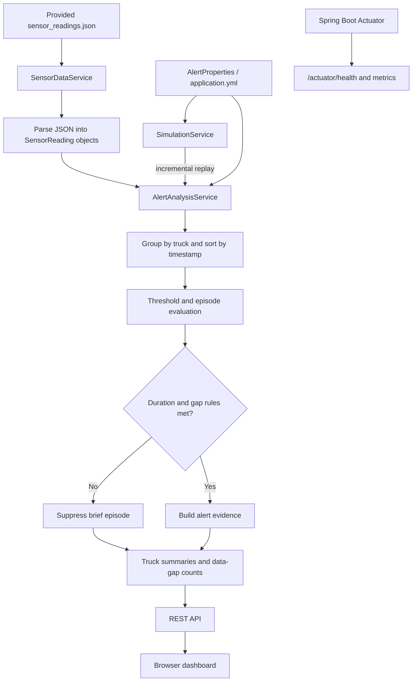
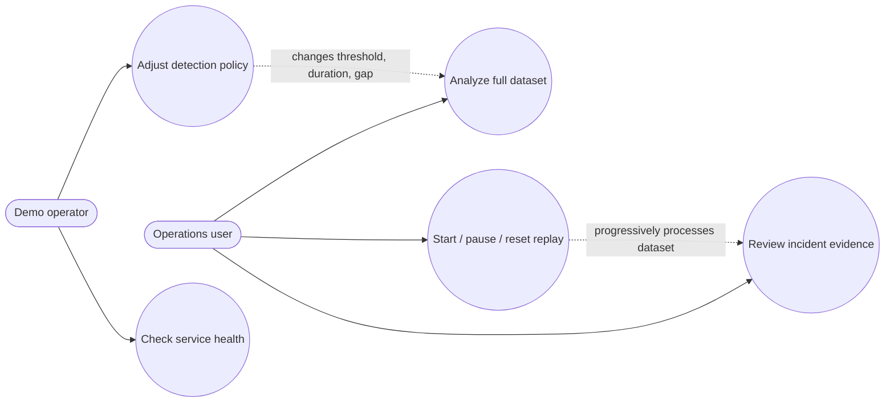

# ReeferGuard — Dynamic Cold-Chain Alerting Engine

## 1. Problem and outcome

Nimbus Freight's operations team is overwhelmed by threshold alerts while genuine temperature failures can be missed. The system must reduce noise without equating “no alert” with “safe.” It groups readings into truck-specific episodes, suppresses short spikes, raises an alert for sustained excursions, and makes sensor-data gaps visible.

This is a local, demo-ready Spring Boot application built around the supplied `sensor_readings.json` dataset. It offers both a full-dataset analysis and a replay mode that reveals results progressively in the browser.

## 2. Assumptions and rules

These are demo defaults, not pharmaceutical or grocery compliance guidance. Real thresholds and excursion windows must be confirmed with the customer and cargo-specific SOPs.

| Rule | Demo default | Reason |
|---|---:|---|
| Temperature violation | `temperature > 8°C` | Explicit, adjustable starting point |
| Minimum sustained duration | 15 minutes | Filters a single brief spike |
| Maximum allowed gap inside an episode | 6 minutes | With nominal five-minute readings, a ten-minute gap breaks continuity |
| High severity | Peak temperature `>= 12°C` | Illustrative prioritization rule |
| Recovery | Not implemented as a persistent incident state | MVP analyzes snapshots rather than maintaining an operational incident lifecycle |

A qualifying episode is a sequence of above-threshold readings for one truck. The timestamp difference between its first and last readings must meet the minimum duration. A non-violating reading ends an episode. A gap greater than the configured maximum breaks an episode. Readings are sorted by timestamp per truck before evaluation, so input ordering does not affect the batch result.

**Safety principle:** a data gap is not evidence that the cargo is safe. The current MVP counts gaps above the configured limit and shows them in the truck summary. A production service should create a distinct stale-sensor/data-quality incident and alert on it independently of temperature analysis.

## 3. High-level architecture

### Components

- **Spring Boot application:** application lifecycle and dependency injection.
- **`SensorDataService`:** reads the provided JSON file and maps records to typed Java records. It can return original input order for replay or a chronological view.
- **`AlertAnalysisService`:** groups by truck, sorts timestamps, identifies above-threshold episodes, applies duration/gap rules, and builds an explainable response.
- **`AlertProperties`:** centralizes threshold, duration, maximum gap, severity threshold, and replay speed in `application.yml`.
- **`SimulationService`:** replays input records incrementally, exposing current progress and results for the UI. It deliberately re-analyzes the processed prefix to keep this demo understandable; it is not a scalable streaming architecture.
- **`AlertController`:** exposes analysis, simulation controls, policy configuration, and a lightweight health endpoint.
- **Dashboard:** uses the REST API to show KPIs, alerts, truck summaries, policy controls, and replay progress.
- **Actuator:** provides standard Spring Boot health and metrics endpoints.

## 4. Use-case diagram

## 5. Main processing flow

1. Read JSON records and parse truck ID, timestamp, temperature, and humidity.
2. Group readings by truck and sort each truck's readings by timestamp.
3. Mark a reading as violating when temperature is strictly greater than the configured threshold.
4. Group consecutive violating readings into episodes. A normal reading or a gap larger than the configured maximum closes the current episode.
5. Calculate duration from the first and last timestamps. Suppress episodes shorter than the configured duration.
6. For qualifying episodes, return a stable set of evidence fields: truck, time window, duration, violating-reading count, peak temperature, severity, and reason.
7. Return truck summaries and counts through the REST API. The dashboard renders the result.

## 6. REST API

| Method | Endpoint | Purpose |
|---|---|---|
| `GET` | `/api/analysis` | Analyze the complete supplied dataset |
| `GET` | `/api/config` | Read current in-memory detection settings |
| `PUT` | `/api/config?thresholdC=8&minDurationMinutes=15&maxGapMinutes=6` | Validate and update detection settings |
| `GET` | `/api/simulation` | Read replay status and latest partial analysis |
| `POST` | `/api/simulation/start` | Start incremental replay |
| `POST` | `/api/simulation/stop` | Pause replay |
| `POST` | `/api/simulation/reset` | Reset replay to the first reading |
| `GET` | `/api/health` | Simple application status |
| `GET` | `/actuator/health` | Spring Boot Actuator health |
| `GET` | `/actuator/metrics` | Actuator metrics index |

## 7. Key design decisions

- **Per-truck isolation:** readings from different trucks cannot be combined into one episode.
- **Timestamp ordering:** the supplied data contains out-of-order readings; sort before calculating duration.
- **Duration from timestamps:** duration is not inferred from reading count alone.
- **Gap-aware episodes:** long gaps break continuity rather than assuming the truck stayed above threshold during the missing period.
- **Alert evidence:** the result includes a reason, peak, duration, and reading count so an operator can understand why it qualified.
- **Configurable policy:** thresholds can be changed from the UI and applied without recompiling.
- **No external side effects:** the local demo does not send real email/SMS notifications.

## 8. Limitations and next production steps

This project is intentionally richer than a static batch script but remains a local proof of concept:

1. Analysis is in memory; incidents are not persisted across restarts.
2. Replay re-analyzes the processed prefix and is for demonstration, not high-throughput ingestion.
3. Re-analysis can assign new incident IDs; production should maintain a persistent incident key/state and send one notification on transition into `ACTIVE`.
4. Recovery state, escalation timers, notification retries, and acknowledgements are not implemented.
5. Data gaps are counted but do not yet create independent sensor-health incidents.
6. The policy update is in memory and resets to `application.yml` after restart.
7. No database, message broker, authentication, or external notification provider is included to keep local setup simple.

Recommended production evolution: add PostgreSQL for readings/incidents, a unique incident key and lifecycle (`NORMAL → SUSPECTED → ACTIVE → RECOVERED`), stale-sensor alerts, notification outbox/retries, audit history, authentication, and load tests. A broker or streaming platform is only justified if actual throughput and reliability needs require it.

## 9. Acceptance checks

- A one-reading spike is suppressed.
- A continuous episode meeting the duration rule creates an alert.
- A gap longer than the configured maximum splits the episode.
- Out-of-order records are sorted before evaluation.
- A reading for one truck never changes another truck's episode.
- Updating policy changes the next analysis.
- Replay can start, pause, reset, and complete locally.
